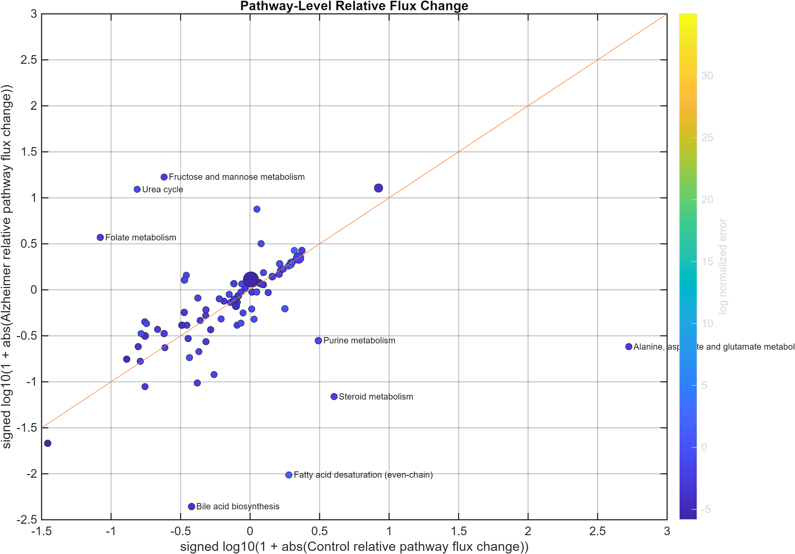
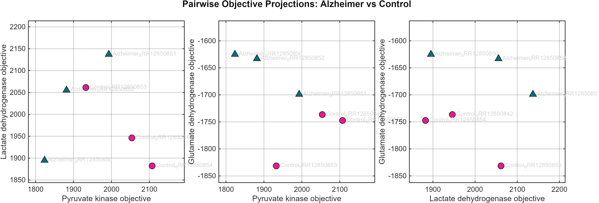

# GEMsplice HumanGEM Alzheimer Analysis

This repository is a curated portfolio version of an Alzheimer/control transcriptomics and genome-scale metabolic modeling workflow.

The project integrates Salmon transcript quantification outputs, transcript-to-gene/reaction mapping, Human-GEM-derived model resources, and GEMsplice/iMAT-style analysis scripts to compare Alzheimer and control sample behavior at the pathway and objective-function level.

## Background

Gene-level summaries can hide which transcripts are actually expressed. This project keeps transcript-level expression in view and asks how Alzheimer and control samples compare once that expression is mapped onto a genome-scale model of human metabolism.

## Method in Brief

1. Quantify transcripts from public RNA-seq data with Salmon ([PRJNA670209](https://www.ncbi.nlm.nih.gov/bioproject/PRJNA670209); 3 Alzheimer and 3 control samples).
2. Map transcripts to genes and Human-GEM reactions.
3. Run GEMsplice and iMAT-style analyses for each sample.
4. Compare objective values and pathway-level flux changes between groups.

The steps and entry points are described in [`docs/workflow.md`](docs/workflow.md).

## Selected Figures

**Pathway-level relative flux change.** Each point is one metabolic pathway, comparing control and Alzheimer relative flux changes.



**Pairwise objective projections.** Each point is one sample, shown across pairs of objective values.



## Limitations

- This is a small exploratory comparison of 3 Alzheimer and 3 control samples, so results are not disease findings.
- It uses public data and is for research support only: no clinical diagnosis, treatment decisions, or patient-specific interpretation.
- Raw data and large model files are not included, so the full workflow cannot be rerun from this repository alone.

Further detail is in [`docs/limitations.md`](docs/limitations.md).

## Repository Scope

This repository intentionally contains only the clean code, compact summary outputs, selected figures, and one final report needed to understand the finished analysis. Large model binaries, raw sequencing data, Salmon indexes, solver experiments, local environment notes, and archived development folders are not included.

## Project Structure

```text
gemsplice-humangem-alzheimer-analysis/
  README.md
  .gitignore
  LICENSE
  CITATION.md

  external/
    original_gemsplice/
      README.md
      LICENSE
      source_code/

  src/
    matlab/
    python/

  results/
    summary_tables/
    figures/
      humangem_tx2gene/
      imat_humangem_rules/
      imat_ad_objectives/
    reports/

  docs/
    workflow.md
    data_availability.md
    limitations.md
```

## Included Code

### Original GEMsplice Reference

Original GEMsplice reference scripts are stored under `external/original_gemsplice/` with their original README and license. These files are kept separate from the project-specific analysis code.

### Project MATLAB Code

The MATLAB scripts in `src/matlab/` represent the curated Alzheimer/control analysis workflow:

- `build_patients_from_salmon_quants.m`
- `build_imat_dati_micro.m`
- `load_imat_gemsplice_model.m`
- `plot_GEMsplice_iMAT_alz_vs_control.m`
- `save_gemsplice_plot_outputs.m`
- `write_imat_gemsplice_summary.m`

### Project Python Code

The Python scripts in `src/python/` support report generation and isoform-to-reaction mapping:

- `build_isoform_mapping.py`
- `build_final_master_report.py`

## Included Results

Compact result artifacts are included under `results/`:

- Summary comparison tables in `results/summary_tables/`
- Figure panels and figure text summaries for:
  - HumanGEM tx2gene log2 results
  - iMAT HumanGEM-rule results
  - iMAT Alzheimer-objective results
- One final PDF report in `results/reports/final_gemsplice_humangem_imat_report.pdf`

## Reproducibility Notes

This is a curated research portfolio repository, not a full raw-data reproduction package. The large input files required to rerun the full workflow are documented in `docs/data_availability.md`.

## Authorship

The analysis code and project work were authored by Burak Keskin. Codex was used to help curate the repository structure and draft documentation for a clean GitHub portfolio presentation.

## Documentation

- `docs/workflow.md`: high-level workflow
- `docs/data_availability.md`: included and excluded data policy
- `docs/limitations.md`: scope and interpretation limits
